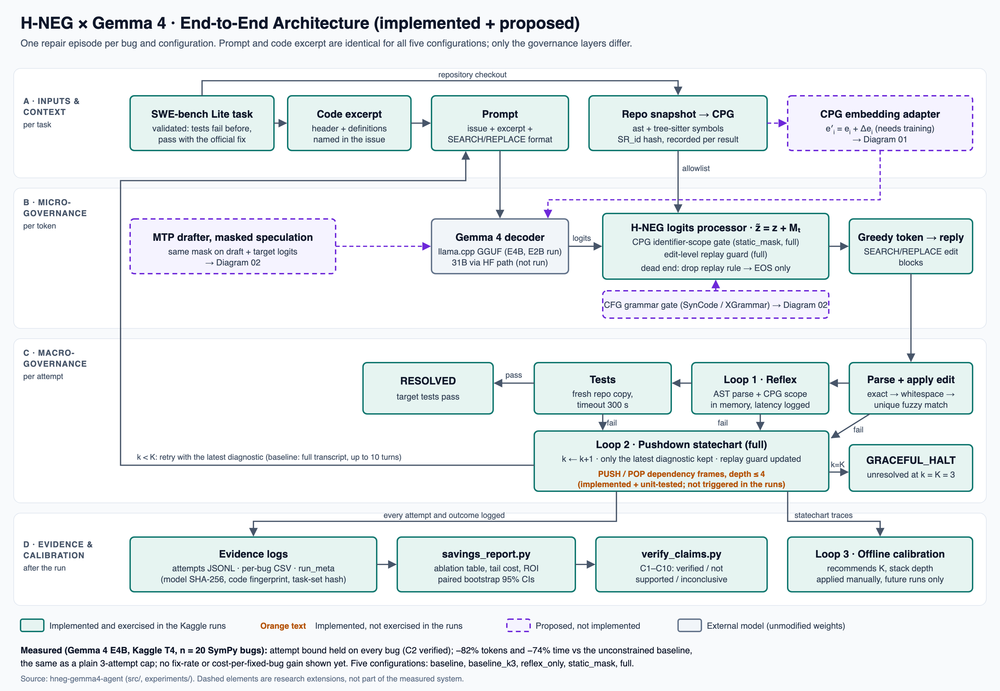
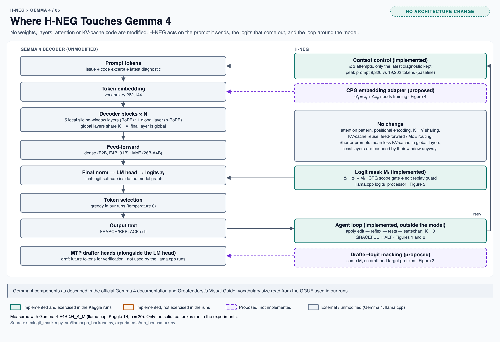
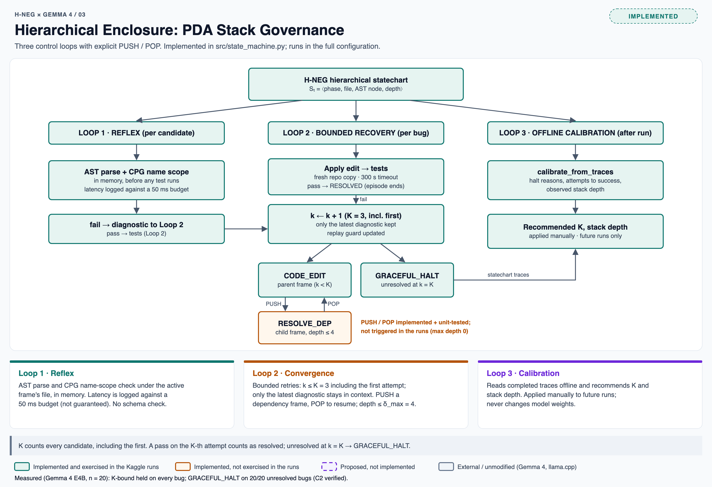
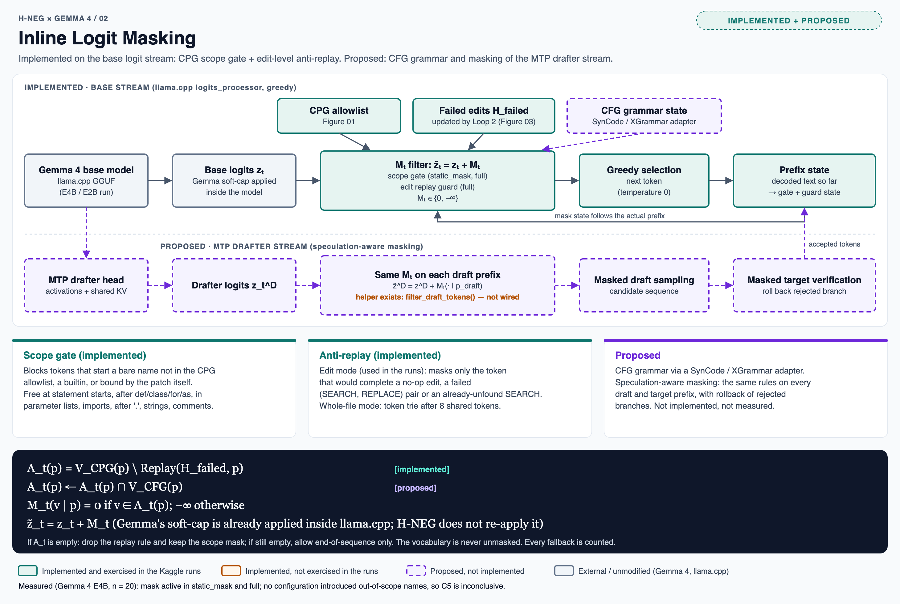
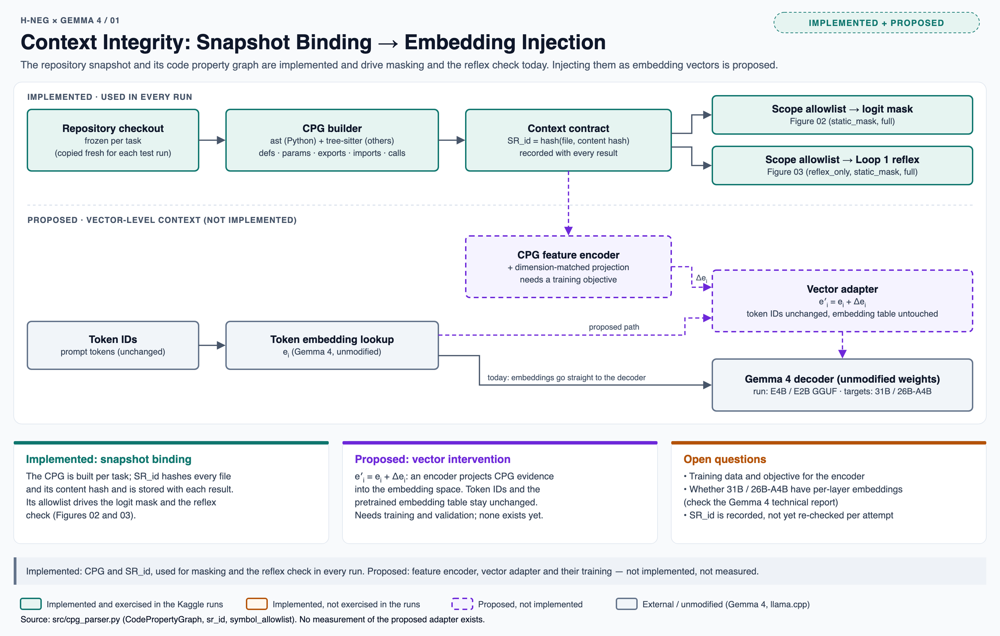

# Deterministic Loop Breaking: Neuro-Symbolic Execution Governance for Local Gemma 4 Coding Agents

*A bounded, logit-masking runtime for small-model repair agents, and a controlled ablation that shows where its savings actually come from.*

**Track:** Overall Best Paper · Best New Resource  **License:** [Apache 2.0](LICENSE)  
**Artifacts:** [GitHub repository](https://github.com/PDawda/hneg-gemma4-agent) · [public Kaggle notebook](https://www.kaggle.com/code/pritidawda/hneg-gemma4) (source: [`notebooks/HNEG_Kaggle_Run.ipynb`](notebooks/HNEG_Kaggle_Run.ipynb)) · result files in [`results/E4B_411d9fd39892a989/`](results/E4B_411d9fd39892a989/README.md)

---

## At a glance

Gemma 4 E4B (Q4_K_M GGUF, one Kaggle T4), 20 validated SWE-bench Lite tasks, five-arm ablation. All numbers are measured unless marked "projected".

| Result | Value | Source |
| :-- | :-- | :-- |
| Tokens per bug, `full` vs unconstrained `baseline` | **−82.2%** [95% CI 79.6, 84.5] | Table 4 |
| Time per bug, `full` vs `baseline` | **−74%** (3.87× faster [3.10, 4.96]) | Tables 3, 4 |
| Worst-case tokens for one bug | **137,311 → 27,093** (5× lower) | Table 3 |
| Same retry cap, no governance (`baseline_k3`) vs `baseline` | **−82.6%** tokens [80.1, 84.8], 4.98× faster | Table 4 |
| `full` vs `baseline_k3` (what governance adds beyond the cap) | tokens −2.2% [−5.8, 0.4] (none); **0.78× speed** (≈29% slower) | Table 4 |
| Baseline tokens spent re-submitting an already-failed patch | **76%** (133 of 192 attempts) | F2 |
| Re-submitted failed patches, `baseline_k3` → `full` | **20 → 3**; loop rate 60% → 10% | Table 3, F2 |
| Distinct retries out of 40, `baseline_k3` → `full` | **20 → 37 (1.85×)** at equal token cost | F2 |
| Peak prompt per attempt, `baseline` → `full` | 19,202 → 9,320 tokens | Table 1 |
| Bugs resolved | `baseline` 1/20, all other arms 0/20 (McNemar p = 1) | Table 3, F4 |
| Claims (Table 5) | 3 verified · 3 not supported · 5 inconclusive | Table 5 |
| Projected ceiling of the proposed components | ≤ ~30% of `full`'s compute (grammar ≤ 18%, context ≤ 12%) | Table 6 |

---

## Abstract

Local coding agents on small open models waste most compute on failed repairs: they retry, append each traceback to a growing prompt, and often re-submit the same broken patch. We present **H-NEG** (Hierarchical Neuro-Symbolic Execution Governance), a runtime that wraps an unmodified Gemma 4 model with (i) a pushdown statechart that bounds every repair episode to *K* attempts and ends it with a deterministic `GRACEFUL_HALT`, (ii) a logit mask that keeps referenced identifiers inside a repository code-property-graph (CPG) scope, and (iii) an **edit-level anti-replay guard** that masks the completion of a previously failed edit. We evaluate it on 20 validated SWE-bench Lite tasks with Gemma 4 E4B (4-bit GGUF, one Kaggle T4), in a five-arm ablation that includes a control most efficiency studies omit: the same retry cap *without* any governance. H-NEG cuts tokens per bug by **82% [95% CI 80–85]** and time by **74%** versus an unconstrained agent, and bounds worst-case cost from 137k to 27k tokens. The control explains essentially all of that saving: a plain 3-attempt cap achieves 83%. Beyond the cap, the governance layers cut re-submitted failed patches from 20 to 3 but add no measurable token or resolution benefit at this model size. A released claim checker reports which claims held, which failed and why.

## 1. Introduction

Local coding agents need small models, which fail often. In a flat self-repair loop (patch, test, feed back the error, retry), every failure costs a prefill of a growing prompt plus a decode. We call this the **agentic compute tax**:

$$\text{Cost} = \sum_{t=1}^{T} \Big( N_{\text{in}}^{(t)}\,\tau_{\text{prefill}} + N_{\text{out}}^{(t)}\,\tau_{\text{decode}} + C_{\text{exec}}^{(t)} \Big)$$

If each failed turn appends similar diagnostic text, the prompt grows linearly, so cumulative input tokens grow quadratically in *T*. Nothing guarantees termination or stops the model re-submitting a failed patch.

H-NEG addresses this at two levels: a **macro** controller (a pushdown statechart) bounds attempts and context, and a **micro** controller (a logits processor) constrains emission using a repository code property graph and a record of failed edits. Neither touches model weights.

Because any agent that stops earlier is cheaper, we built the evaluation around a **retry-cap control** and a tool that checks each claim against the data. Contributions:

- **A governance runtime for Gemma 4** (Hugging Face and llama.cpp backends): bounded statechart with `GRACEFUL_HALT`, CPG scope masking, a reflex check and offline calibration.
- **Edit-level anti-replay.** The usual token-prefix "failure trie" is counterproductive when the model answers with SEARCH/REPLACE edits; we replace it with a guard that masks only the token that would *complete* a known-bad edit.
- **A controlled five-arm ablation** showing that, for Gemma 4 E4B, the savings come from bounding attempts, not masking.
- **A verifiable evaluation resource:** task validation, provenance-stamped runs, bootstrap-CI reports and a claim checker (VERIFIED / NOT SUPPORTED / INCONCLUSIVE).


*Figure 1: End-to-end architecture: inputs, per-token micro-governance (logit masking), per-attempt macro-governance (statechart), and evidence logs. Solid boxes are implemented and exercised; dashed boxes are proposed research extensions.*

## 2. Related Work

**Agent loops and self-repair.** ReAct [1] interleaves reasoning and tool use; Reflexion [2] and Self-Refine [3] feed verbal feedback into later attempts. None has a structural stopping rule beyond a turn limit.

**Software-engineering agents and benchmarks.** SWE-bench [4] evaluates agents on real GitHub issues. SWE-agent [5] shows that the agent–computer interface, such as the edit format, strongly affects success; Agentless [6] shows a fixed localise–repair–validate pipeline is competitive with open-ended agents.

**Constrained decoding.** Willard and Louf [7] compile regular and context-free constraints into token masks; SynCode [8] and XGrammar [9] make grammar-constrained decoding efficient for programming languages. H-NEG uses the same mechanism (−∞ on disallowed logits) but constrains *identifier scope* from a repository graph and *failure replay* from execution history rather than syntax; a grammar engine plugs into the same interface.

**Code property graphs.** Yamaguchi et al. [10] merge syntax trees, control flow and data dependence into one graph. We build a lightweight variant (definitions, parameters, exports, imports, calls) and use it as a decoding-time scope constraint.

## 3. Method

Figure 1 shows the full system; Figures 2–5 detail it. Solid boxes were implemented and exercised; dashed boxes are proposed.

### 3.0 What changes in Gemma 4, and what does not

H-NEG modifies **no** weights, layers or inference code; it acts on the prompt, the output logits and the surrounding loop (Figure 2).

**Table 1.** Gemma 4 components and H-NEG's change to each.

| Gemma 4 component | H-NEG change | Status |
| :-- | :-- | :-- |
| Weights, tokenizer, embeddings | none | – |
| Hybrid local/global attention, p-RoPE, shared K = V cache | none; bounded context lowers peak prompt from 19,202 to 9,320 tokens | measured |
| Dense / MoE feed-forward | none | – |
| Final logits | mask $M_t$ added after the model's own soft-cap | implemented |
| Token selection | greedy, unchanged | – |
| Embedding input | CPG offsets $e'_i = e_i + \Delta e_i$ | proposed |
| MTP drafter heads | same mask on draft logits | proposed |


*Figure 2: Where H-NEG attaches to the Gemma 4 execution stack, without modifying weights or the attention architecture.*

### 3.1 Macro-governance: a bounded pushdown statechart

Each repair episode is a statechart with frames $S_t = \langle \Phi, \mathcal{F}, \Sigma_{\text{AST}}, \delta \rangle$: phase, file scope, AST node and stack depth. Sub-tasks (e.g. resolving a missing dependency) are **pushed** as child frames and **popped** on completion; depth ≤ $\delta_{\max} = 4$. Three loops run at different time scales (Figure 3):

- **Loop 1 (reflex):** before any test runs, each candidate file is parsed in memory; in the masked arms, every loaded bare name is also checked against the CPG allowlist. Latency is logged against a 50 ms budget.
- **Loop 2 (bounded recovery):** the edit is applied to a fresh copy of the repository and the task's tests run (300 s timeout). On failure, the attempt counter *k* increases, and only the latest diagnostic is kept in the prompt. At *k = K* (default 3, counting the first attempt), the episode ends in `GRACEFUL_HALT`; a pass on the *K*-th attempt counts as resolved.
- **Loop 3 (calibration):** offline, `calibrate_from_traces` reads completed statechart traces and recommends *K* and the stack depth. Recommendations are applied manually to future runs; model weights are never changed.


*Figure 3: Hierarchical PDA stack governance: Loop 1 (reflex AST checks), Loop 2 (bounded K-ceiling recovery) and Loop 3 (offline calibration).*

### 3.2 Micro-governance: inline logit masking

At every decoding step, the logits processor computes $\tilde z_t = z_t + M_t$ with $M_t(v) \in \{0, -\infty\}$ and allowed set

$$A_t(p) = V_{\text{CPG}}(p) \setminus \text{Replay}(H_{\text{failed}}, p)$$

where *p* is the text generated so far (Figure 4). H-NEG does not apply a second soft-cap: we rely on the backend's model graph for Gemma's final-logit capping. If $A_t$ is empty, the replay rule is dropped and the scope mask kept; if that is still empty, only end-of-sequence is allowed. The vocabulary is never unmasked, and every such fallback is counted.

**Scope gate ($V_{\text{CPG}}$).** The gate blocks tokens that would *start* a reference to a bare name that is not in the CPG allowlist, not a builtin, and not bound by the patch itself. It stays unconstrained wherever a new name may legitimately appear (statement starts, after `def`/`class`/`for`/`as`, parameter lists, imports, after `.`, strings and comments): a conservative scope filter, not a grammar.

**Edit-level anti-replay.** The model answers with SEARCH/REPLACE blocks (lines copied from the file, then their replacement). A classic failure trie masks the next token once output shares a prefix with a failed one; but every edit reply starts with the same fence, marker and anchor lines, so prefix masking pushes the model *off correct anchors*. In a two-bug pilot (Gemma 4 E2B), the full pipeline with this trie was slower than a plain retry cap. The replay guard instead masks only the single token that would *complete*:

- an edit whose REPLACE equals its SEARCH (a no-op);
- a (SEARCH, REPLACE) pair that already failed;
- a SEARCH text that was already not found in the file.

Comparison ignores whitespace; the rest of the reply stays free.


*Figure 4: Micro-governance inline logit masking: base-stream logit filtering (implemented) alongside speculative draft masking (proposed).*

### 3.3 Repository context

The CPG is built per task with Python's `ast` module (tree-sitter for other languages); a snapshot hash $SR_{id}$ binds results to the exact source. The model sees a deterministic excerpt (import header plus the definitions named in the issue, ≤ 24,000 characters), **identical for every configuration**. Embedding injection (Figure 5), grammar constraints and drafter masking are designed but **not implemented**.


*Figure 5: Context-integrity contract: snapshot hash $SR_{id}$ binding (implemented) and the proposed vector-level CPG embedding-injection adapter.*

## 4. Experimental Setup

**Tasks.** We sampled SWE-bench Lite [4] instances (seed 0) and kept an instance only if its target tests *fail* on the original code and *pass* with the official fix in our environment (Python 3.13, no Docker). Of 37 candidates checked, 20 passed, all from SymPy; the pytest and Requests candidates and 12 SymPy candidates failed validation under Python 3.13 (for example, old releases importing `collections.Mapping`). Passing these local tests is not equivalent to official SWE-bench grading.

**Configurations.** All five arms use the same prompt, excerpt, edit format, greedy decoding (temperature 0) and model.

**Table 2.** The five ablation arms.

| Arm | Attempts | Context on retry | Reflex | Scope mask | Anti-replay + statechart |
| :-- | :-: | :-- | :-: | :-: | :-: |
| `baseline` | ≤ 10 | full transcript | – | – | – |
| `baseline_k3` | ≤ 3 | latest diagnostic | – | – | – |
| `reflex_only` | ≤ 10 | latest diagnostic | ✓ | – | – |
| `static_mask` | ≤ 10 | latest diagnostic | ✓ | ✓ | – |
| `full` | ≤ 3 | latest diagnostic | ✓ | ✓ | ✓ |

In `reflex_only` the reflex check is syntax-only; with the mask it also checks names. `baseline_k3` is the key control: it has the same cap and short context as `full`, but no governance. **`full` vs `baseline_k3` measures what H-NEG adds beyond stopping early.**

**Model and hardware.** Gemma 4 E4B-it [11], Q4_K_M GGUF (SHA-256 `85a896a0…`), llama-cpp-python 0.3.36 (CUDA), one T4, 32,768-token context, ≤ 1,024 new tokens per reply.

**Metrics.** Tokens and wall time per bug over all attempts (prefill, decode, tests). *Resolved* means the target tests pass within the arm's attempt budget (Pass@budget, not first-attempt Pass@1). *Loop rate* is operational: the episode ran out of attempts while re-submitting an identical (whitespace-normalised) patch.

**Statistics.** Paired 95% bootstrap CIs over bugs (10,000 resamples); exact McNemar tests for resolution; only bugs completed by every arm.

**Provenance.** `run_meta.json` records the model SHA-256, code fingerprint (`411d9fd39892a989`), task-set hash and every setting; resuming with a different model, code or settings is refused.

## 5. Results

### 5.1 Ablation (Gemma 4 E4B, n = 20)

**Table 3.** Per-arm results.

| Arm | Tokens / bug | Time / bug | Worst-case tokens | Resolved | Loop rate | Re-submitted patches |
| :-- | --: | --: | --: | :-: | :-: | --: |
| `baseline` | 73,282 | 219 s | 137,311 | 1/20 | 95% | 133 |
| `baseline_k3` | 12,747 | 44 s | 27,093 | 0/20 | 60% | 20 |
| `reflex_only` | 44,485 | 127 s | 95,519 | 0/20 | 100% | 142 |
| `static_mask` | 44,675 | 152 s | 95,519 | 0/20 | 95% | 135 |
| `full` | 13,030 | 57 s | 27,093 | 0/20 | 10% | 3 |

**Table 4.** Paired comparisons (95% bootstrap CI over bugs).

| Paired comparison | Token reduction | Speedup |
| :-- | :-: | :-: |
| `full` vs `baseline` | **82.2%** [79.6, 84.5] | **3.87×** [3.10, 4.96] |
| `baseline_k3` vs `baseline` | **82.6%** [80.1, 84.8] | **4.98×** [3.76, 6.86] |
| `full` vs `baseline_k3` | −2.2% [−5.8, 0.4] | 0.78× [0.64, 0.89] |

At an assumed $0.35/h, GPU cost per bug is $0.021 (`baseline`), $0.0055 (`full`), $0.0043 (`baseline_k3`).

### 5.2 Findings

**F1: Bounding attempts is what saves compute.** `full` and `baseline_k3` save the same ~82% of tokens. Against the cap-only control, the governance layers add no token saving (CI includes 0) and cost about 29% more wall time (57 s vs 44 s per bug; speedup CI excludes 1). Without this control, masking would be credited with savings a one-line retry limit achieves.

**F2: Without a cap, small models loop.** In `baseline`, **76% of all tokens** went to exact repeats of an already-failed patch (133 of 192 attempts); under greedy decoding a repeat cannot succeed. Masking alone (`static_mask`) did not change this. The cap limited it, and on top of the cap the replay guard cut re-submitted patches from 20 (`baseline_k3`) to 3 and the loop rate from 60% to 10%. Of 40 retries per arm, `full` made 37 distinct ones versus 20 (1.85×) at equal token cost: the one measurable benefit of governance in this run.

**F3: The model, not the harness, limits resolution.** Of about 700 attempts, one resolved a bug; roughly half applied cleanly but failed the tests. About a quarter used SEARCH text that could not be located in the file; in the cases we inspected, the model quoted code that does not exist. No arm introduced out-of-scope identifiers, so the scope gate had nothing to prevent.

**F4: Small-model agents are sensitive to interface details.** The single fix (sympy-22714, `baseline`, turn 2) came from a prompt differing from `baseline_k3`'s only in retry wording ("Try again." vs "Produce a different fix."); under greedy decoding that alone changed the reply (not significant, McNemar *p* = 1).

### 5.3 Claim verification

The claim checker ([`experiments/verify_claims.py`](experiments/verify_claims.py)) tests each design claim against the data.

**Table 5.** Claim verdicts.

| Claim | Verdict | Evidence |
| :-- | :-: | :-- |
| C2 · attempts bounded by K = 3, then `GRACEFUL_HALT` | ✅ Verified | max 3 attempts on every bug; worst case 27k vs 137k tokens |
| C6 · fewer tokens than unconstrained agent | ✅ Verified | −82% [80, 85]; equal to the cap alone (F1) |
| C7 · faster than unconstrained agent | ✅ Verified | 3.9× [3.1, 5.0]; cap alone 5.0× |
| C1 · no loops | ❌ Not supported | 10% (2 bugs) |
| C3 · failed patch never re-submitted | ❌ Not supported | 3 repeats |
| C4 · 0% syntax failures | ❌ Not supported | 4 of 35 applied patches (11%) |
| C5 · no out-of-scope names | ⚠️ Inconclusive | 0% in every arm |
| C8 · value beyond the retry cap | ⚠️ Inconclusive | 0/20 vs 0/20 resolution; negative on latency |
| C9, C10 · higher resolution, lower cost per resolved bug | ⚠️ Inconclusive | too few resolutions |

We traced every failure behind C1, C3 and C4:

- **(a) Separator mis-parse:** indented docstring underlines (`========`) were taken for edit separators, causing one looping bug (sympy-18532), three of four syntax failures (sympy-18835), and an estimated 5–12% wrongly rejected attempts in *every* arm.
- **(b) Guard evasion:** on sympy-17630, with the separator after a failed SEARCH masked, the model closed the block without one and repeated that reply.
- **(c) A genuine model error:** the fourth syntax failure (sympy-15308) is a mis-indented replacement, which a scope mask cannot prevent.

The released code fixes (a) and (b) (column-0 markers; both escape routes masked), after this run. Because of (c), C4 should stay unsupported without a grammar constraint.

## 6. Discussion

**What generalizes** (all model-agnostic):

- **The bound.** Any agent loop gains a hard per-task cost ceiling (5× lower worst case here).
- **Edit-level anti-replay** for any agent emitting SEARCH/REPLACE or diff edits, where token-prefix exclusion is harmful.
- **The evaluation protocol:** *guarantees* (checkable at any n) separated from *effects* (statistical), a cap-only control, and hash-stamped results.

**Why adopt governance beyond the cap?** Not for money: the bound delivers the savings. Anti-replay improves the budget's quality (1.85× more distinct retries per token), which converts into fixes only with a model that can fix bugs; the break-even rule below says when that pays.

**Projected savings of the proposed design (not measured).** Each proposed component targets one failure class; that class's measured share of compute is the ceiling on what the component can recover.

**Table 6.** Failure classes, their share of compute, and the component that targets each.

| Failure class | Share of tokens | Targeted by | Status |
| :-- | :-: | :-- | :-- |
| Exact repeat of a failed patch | 76% (`baseline`) → 4% (`full`) | cap + anti-replay | measured |
| Malformed edit or syntax error | 18% (`full`) | grammar constraint | proposed |
| SEARCH text not in the file | 12% (`full`) | CPG context injection | proposed |
| Applied but wrong fix | 66% (`full`) | none (model capability) | – |

Together, the proposed components could convert at most ~30% of `full`'s compute from structurally invalid attempts into attempts that reach the tests. Under a fixed *K*, that yields more valid attempts per bug, not fewer tokens; it lowers cost per resolved bug only if those attempts fix bugs. Drafter masking would affect latency only and is not estimated. Per resolved bug, the bound saves $1 - 0.178\,p_B/p_H$ (token ratio 0.178): 82% at equal fix rates, breaking even only if H-NEG keeps under 18% of the baseline's fixes.

**Limitations.** n = 20 tasks from one repository; one 4B model; local tests, not official SWE-bench grading; greedy decoding, one seed. With one resolution, resolution and cost-per-resolved claims remain untested. The 31B and 26B-A4B targets were not run. PUSH/POP is unit-tested but never triggered (maximum depth 0).

## 7. Reproducibility

Released under Apache 2.0:

- `src/`: statechart, logits processor, replay guard, CPG, llama.cpp backend.
- `experiments/`: task validation, resumable benchmark, savings report, claim checker.
- 75 unit tests (one with live llama.cpp decoding) and a [public Kaggle notebook](https://www.kaggle.com/code/pritidawda/hneg-gemma4) running everything on one T4.

All numbers come from the released result files in [`results/E4B_411d9fd39892a989/`](results/E4B_411d9fd39892a989/README.md): per-attempt logs, per-bug CSVs, `run_meta.json`, `savings_report.md`, `claims_verification.md` (code `411d9fd39892a989`, task set `4be1f94b78ccc176`), shipped with that code snapshot. The released code (`918612c5e74163c1`) adds the §5.3 fixes and has not been re-measured, so rerunning it will give different numbers.

### Quickstart

```bash
pip install -r requirements.txt            # Python >= 3.10
python -m pytest -q tests                  # 74 pass + 1 skipped without a live llama.cpp model

# Rebuild Tables 3-5 from the released result files (no GPU needed)
cp -R results/E4B_411d9fd39892a989 /tmp/regen
python experiments/savings_report.py --results-dir /tmp/regen --gpu-cost-per-hour 0.35
python experiments/verify_claims.py  --results-dir /tmp/regen --gpu-cost-per-hour 0.35
```

**Full run on Kaggle (T4).** The [public notebook](https://www.kaggle.com/code/pritidawda/hneg-gemma4) ([`notebooks/HNEG_Kaggle_Run.ipynb`](notebooks/HNEG_Kaggle_Run.ipynb)) runs everything step by step: environment check, llama.cpp CUDA wheel, tests, task validation, the resumable five-arm ablation, the savings report, the claim checker and Loop 3 calibration. Results go to `results_<model>_<code fingerprint>/`, so a new code version never mixes with earlier runs.

**Run the ablation yourself** (GPU, GGUF backend):

```bash
python experiments/prepare_tasks.py --validate --out experiments/tasks.jsonl     # keeps only tasks that fail before / pass after the official fix
python experiments/run_benchmark.py --backend gguf --tasks experiments/tasks.jsonl \
    --configs baseline baseline_k3 reflex_only static_mask full --trace-dir experiments/traces
python experiments/savings_report.py --results-dir experiments/results --gpu-cost-per-hour 0.35
python experiments/verify_claims.py  --results-dir experiments/results --gpu-cost-per-hour 0.35
python -m src.state_machine experiments/traces                                   # Loop 3 calibration
```

### Repository layout

```text
hneg-gemma4-agent/
├── hneg_config.yaml            control schema (K, stack depth, masking, sandbox model)
├── src/
│   ├── state_machine.py        DynamicStateManager (pushdown statechart), GRACEFUL_HALT, calibrate_from_traces
│   ├── logit_masker.py         IdentifierScopeGate, EditReplayGuard, FailedDiffTrie (whole-file mode), HNEGLogitsProcessor
│   ├── cpg_parser.py           CodePropertyGraph (ast + tree-sitter), SR_id, reflex check
│   └── llamacpp_backend.py     GGUF backend: runner, tokenizer, logits adapter
├── experiments/
│   ├── prepare_tasks.py        SWE-bench Lite sampling and validation
│   ├── edit_format.py          SEARCH/REPLACE parsing and application (same for every arm)
│   ├── run_benchmark.py        five-arm ablation harness, resumable, provenance-locked
│   ├── savings_report.py       Tables 3-4: ablation table, paired bootstrap CIs, tail cost, ROI
│   ├── verify_claims.py        Table 5: VERIFIED / NOT SUPPORTED / INCONCLUSIVE
│   ├── common.py, sandbox_smoke.py
├── results/E4B_411d9fd39892a989/   result files behind every number above + exact code snapshot
├── docs/
│   └── diagrams/                   Figures 1-5 (SVG + PNG)
├── tests/                      pytest suite
└── notebooks/                  HNEG_Kaggle_Run.ipynb (full pipeline), HNEG_Gemma4_Demo.ipynb (walkthrough)
```

### Run history

| Date | Model, code | Tasks | Outcome |
| :-- | :-- | :-: | :-- |
| 2026-11 | Gemma 4 E2B Q4_K_M, pilot | 2 | Token-prefix trie pushed the model off correct anchors (100% edit parse failures); led to the edit-level replay guard. |
| 2026-11-11 | Gemma 4 E4B Q4_K_M, `7885d3d615d4a3bc` | 2 | Edits applied; none resolved; guard escape via a second separator found and fixed. |
| 2026-11-12 | Gemma 4 E4B Q4_K_M, `411d9fd39892a989` | 20 | **The run reported above** (Tables 3–5). |
| not yet run | Gemma 4 E4B Q4_K_M, `918612c5e74163c1` (released) | 20 | Rerun with the §5.3 fixes and unified retry wording; fixes unmeasured until then. |

## 8. Conclusion

Without changing Gemma 4 itself, H-NEG makes the cost of a local repair agent bounded and auditable: with Gemma 4 E4B, worst-case tokens per bug drop five-fold and average tokens by 82%. A cap-only control shows that, at this model size, the bound alone delivers these savings; beyond it, anti-replay cuts re-submitted failed patches from 20 to 3, but the governance layers add about 29% latency without a measurable gain in tokens or resolutions. We release the runtime, the edit-level anti-replay guard, and an evaluation protocol that makes such claims checkable. The next step is to measure the governance layers on models strong enough to resolve a substantial fraction of tasks, where the question they were designed for (fewer wasted attempts per resolved bug) can finally be answered.

## 9. References

1. S. Yao et al. *ReAct: Synergizing Reasoning and Acting in Language Models.* ICLR 2023. arXiv:2210.03629
2. N. Shinn et al. *Reflexion: Language Agents with Verbal Reinforcement Learning.* NeurIPS 2023. arXiv:2303.11366
3. A. Madaan et al. *Self-Refine: Iterative Refinement with Self-Feedback.* NeurIPS 2023. arXiv:2303.17651
4. C. E. Jimenez et al. *SWE-bench: Can Language Models Resolve Real-World GitHub Issues?* ICLR 2024. arXiv:2310.06770
5. J. Yang et al. *SWE-agent: Agent-Computer Interfaces Enable Automated Software Engineering.* NeurIPS 2024. arXiv:2405.15793
6. C. S. Xia et al. *Agentless: Demystifying LLM-based Software Engineering Agents.* arXiv:2407.01489, 2024
7. B. T. Willard, R. Louf. *Efficient Guided Generation for Large Language Models.* arXiv:2307.09702, 2023
8. S. Ugare et al. *SynCode: LLM Generation with Grammar Augmentation.* arXiv:2403.01632, 2024
9. Y. Dong et al. *XGrammar: Flexible and Efficient Structured Generation Engine for Large Language Models.* arXiv:2411.15100, 2024
10. F. Yamaguchi et al. *Modeling and Discovering Vulnerabilities with Code Property Graphs.* IEEE S&P 2014
11. Gemma Team, Google DeepMind. *Gemma 4 Model Documentation and Technical Report.* 2026.

### Related articles by the author

12. P. Dawda. *A Neuro-Symbolic AI Architecture for Explainable Enterprise Decisions.* HackerNoon. https://hackernoon.com/a-neuro-symbolic-ai-architecture-for-explainable-enterprise-decisions
13. P. Dawda. Articles on Medium. https://medium.com/@pritidawda

---

**Author:** Priti Dawda
